<!--
GitHub profile: Ubuntu Terminal Bilingual Edition.
English is visible by default. Expand the Russian version directly on this page.
GitHub cannot read the visitor's browser language for profile README localization.
All graphics are local SVG; light/dark theme switches with prefers-color-scheme; animations respect prefers-reduced-motion.
-->

<details>
<summary><b>🇷🇺 Русский — открыть полную версию профиля / Open Russian version</b></summary>

<div align="center">
<picture>
  <source media="(prefers-color-scheme: dark)" srcset="assets/ru/hero-dark.svg">
  <source media="(prefers-color-scheme: light)" srcset="assets/ru/hero-light.svg">
  
</picture>
</div>

<div align="center">
<a href="https://t.me/IvI_Ivaa"><picture>
  <source media="(prefers-color-scheme: dark)" srcset="assets/shared/contact-telegram-dark.svg">
  <source media="(prefers-color-scheme: light)" srcset="assets/shared/contact-telegram-light.svg">
  
</picture></a>
<a href="mailto:davidenko.irina.work@gmail.com"><picture>
  <source media="(prefers-color-scheme: dark)" srcset="assets/shared/contact-email-dark.svg">
  <source media="(prefers-color-scheme: light)" srcset="assets/shared/contact-email-light.svg">
  
</picture></a>
</div>

### `irina@ubuntu:~$ cat about-me.md`

Привет! Я **Ирина**, frontend-разработчик. Создаю интерфейсы на **React и TypeScript**: от роутинга и форм до интеграции с API. Сейчас изучаю **Next.js (App Router)** на собственном проекте **Film Note**.

```bash
irina@ubuntu:~$ whoami
> Frontend developer | React | TypeScript | Next.js

irina@ubuntu:~$ cat ./education.txt
> Hexlet College · Информационные системы и программирование
> Выпускной курс · выпуск 2027

irina@ubuntu:~$ cat ./career-status.txt
> Открыта к стажировкам и junior frontend-позициям
```

**Опыт тимлидства:** руководила учебной командой из **11 разработчиков**, спроектировала архитектуру и схему БД, настраивала CI и провела ревью **120+ PR**. Ищу frontend-команду, где смогу развиваться.

### `irina@ubuntu:~$ ls ~/stack/ --color=always`

<picture>
  <source media="(prefers-color-scheme: dark)" srcset="assets/shared/stack-dark.svg">
  <source media="(prefers-color-scheme: light)" srcset="assets/shared/stack-light.svg">
  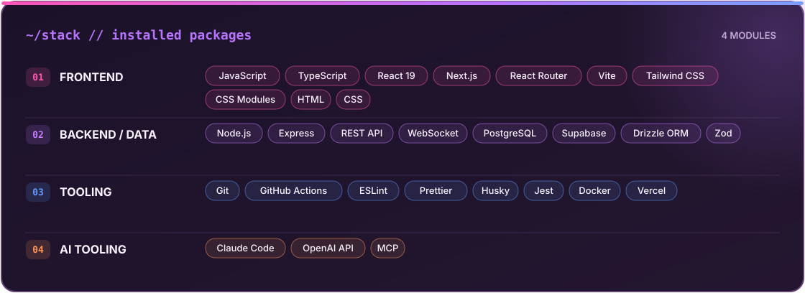
</picture>

### `irina@ubuntu:~$ tree ~/projects/`

```text
~/projects/
├── film-note/            Next.js · фильмы и сериалы
├── github-users-viewer/  React · GitHub API
├── mcp-coffee/           Telegram · MCP · OpenAI
├── personal-blog/        Team Lead · 11 разработчиков
└── realtime-chat/        WebSocket · JWT · Docker
```

<table>
<tr>
<td width="50%" valign="top">
<a href="https://github.com/Ira-Ivaa/film-note"><picture>
  <source media="(prefers-color-scheme: dark)" srcset="assets/ru/film-note-dark.svg">
  <source media="(prefers-color-scheme: light)" srcset="assets/ru/film-note-light.svg">
  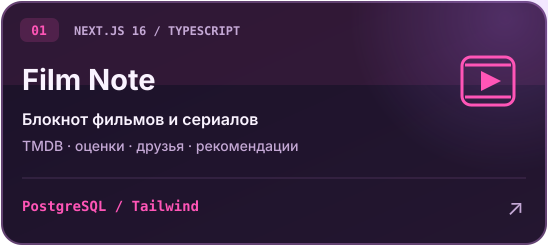
</picture></a>
<br>
<sub>Блокнот фильмов и сериалов: списки, оценки, заметки, поиск по TMDB, друзья и рекомендации. Авторизация на сессиях, деплой на Vercel.<br><a href="https://film-note.vercel.app">Демо</a> · <a href="https://github.com/Ira-Ivaa/film-note">Код</a></sub>
</td>
<td width="50%" valign="top">
<a href="https://github.com/Ira-Ivaa/github-users-viewer"><picture>
  <source media="(prefers-color-scheme: dark)" srcset="assets/ru/github-users-dark.svg">
  <source media="(prefers-color-scheme: light)" srcset="assets/ru/github-users-light.svg">
  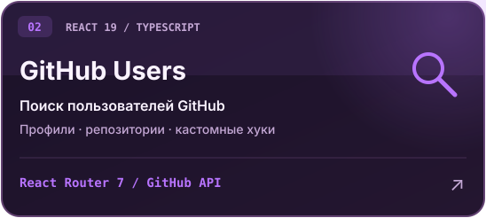
</picture></a>
<br>
<sub>SPA: поиск пользователей GitHub и просмотр профилей с репозиториями. Свои хуки <code>useFetch</code> и <code>useDebounce</code>.<br><a href="https://github-users-viewer-neon.vercel.app">Демо</a> · <a href="https://github.com/Ira-Ivaa/github-users-viewer">Код</a></sub>
</td>
</tr>
<tr>
<td width="50%" valign="top">
<a href="https://github.com/Ira-Ivaa/mcp-coffee"><picture>
  <source media="(prefers-color-scheme: dark)" srcset="assets/ru/mcp-coffee-dark.svg">
  <source media="(prefers-color-scheme: light)" srcset="assets/ru/mcp-coffee-light.svg">
  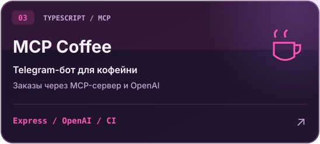
</picture></a>
<br>
<sub>Telegram-бот кофейни принимает заказы свободным текстом через собственный MCP-сервер и OpenAI.<br><a href="https://github.com/Ira-Ivaa/mcp-coffee">Код</a></sub>
</td>
<td width="50%" valign="top">
<a href="https://github.com/Hexlet-EducationalPractice/Personal_blog_2026_02_04"><picture>
  <source media="(prefers-color-scheme: dark)" srcset="assets/ru/personal-blog-dark.svg">
  <source media="(prefers-color-scheme: light)" srcset="assets/ru/personal-blog-light.svg">
  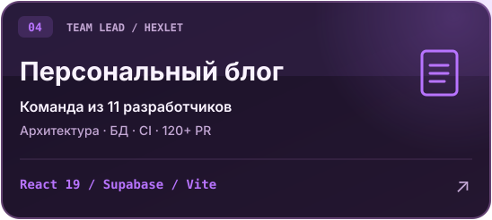
</picture></a>
<br>
<sub>Учебная практика Hexlet College: архитектура, схема БД, CI и ревью более 120 PR в команде из 11 разработчиков.<br><a href="https://github.com/Hexlet-EducationalPractice/Personal_blog_2026_02_04">Репозиторий команды</a></sub>
</td>
</tr>
</table>

**[Real-time Chat](https://github.com/Ira-Ivaa/realtime-chat)** — чат в реальном времени на **WebSocket** с **JWT-авторизацией** и **Docker**.

### `irina@ubuntu:~$ tail -f currently-working-on.log`

```diff
+ Film Note: серверные и клиентские компоненты Next.js
+ Jest: unit-тесты на TypeScript
+ Поиск frontend-команды, где можно расти
```

<div align="center">

<picture>
  <source media="(prefers-color-scheme: dark)" srcset="assets/ru/status-dark.svg">
  <source media="(prefers-color-scheme: light)" srcset="assets/ru/status-light.svg">
  
</picture>

<sub>Спасибо, что заглянули!</sub>

</div>

</details>

<div align="center">
<picture>
  <source media="(prefers-color-scheme: dark)" srcset="assets/en/hero-dark.svg">
  <source media="(prefers-color-scheme: light)" srcset="assets/en/hero-light.svg">
  
</picture>
</div>

<div align="center">
<a href="https://t.me/IvI_Ivaa"><picture>
  <source media="(prefers-color-scheme: dark)" srcset="assets/shared/contact-telegram-dark.svg">
  <source media="(prefers-color-scheme: light)" srcset="assets/shared/contact-telegram-light.svg">
  
</picture></a>
<a href="mailto:davidenko.irina.work@gmail.com"><picture>
  <source media="(prefers-color-scheme: dark)" srcset="assets/shared/contact-email-dark.svg">
  <source media="(prefers-color-scheme: light)" srcset="assets/shared/contact-email-light.svg">
  
</picture></a>
</div>

### `irina@ubuntu:~$ cat about-me.md`

Hi! I'm **Irina**, a frontend developer building interfaces with **React and TypeScript** — from routing and forms to API integration. I'm learning **Next.js (App Router)** while building my own project, **Film Note**.

```bash
irina@ubuntu:~$ whoami
> Frontend developer | React | TypeScript | Next.js

irina@ubuntu:~$ cat ./education.txt
> Hexlet College · Information Systems and Programming
> Final-year student · graduating in 2027

irina@ubuntu:~$ cat ./career-status.txt
> Open to internships and junior frontend roles
```

### `irina@ubuntu:~$ cat leadership.log`

- Led an educational team of **11 developers**.
- Designed the application architecture and database schema.
- Set up CI and reviewed **120+ pull requests**.
- Looking for a frontend team where I can grow and contribute to real products.

### `irina@ubuntu:~$ ls ~/stack/ --color=always`

<picture>
  <source media="(prefers-color-scheme: dark)" srcset="assets/shared/stack-dark.svg">
  <source media="(prefers-color-scheme: light)" srcset="assets/shared/stack-light.svg">
  
</picture>

### `irina@ubuntu:~$ tree ~/projects/`

```text
~/projects/
├── film-note/            Next.js · movies and TV series
├── github-users-viewer/  React · GitHub API
├── mcp-coffee/           Telegram · MCP · OpenAI
├── personal-blog/        Team Lead · 11 developers
└── realtime-chat/        WebSocket · JWT · Docker
```

<table>
<tr>
<td width="50%" valign="top">
<a href="https://github.com/Ira-Ivaa/film-note"><picture>
  <source media="(prefers-color-scheme: dark)" srcset="assets/en/film-note-dark.svg">
  <source media="(prefers-color-scheme: light)" srcset="assets/en/film-note-light.svg">
  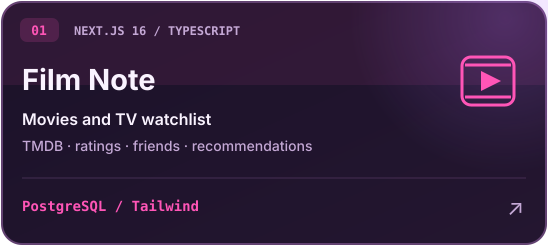
</picture></a>
<br>
<sub>A movie and TV journal: lists, ratings, notes, TMDB search, friends and recommendations. Session-based authentication and Vercel deployment.<br><a href="https://film-note.vercel.app">Demo</a> · <a href="https://github.com/Ira-Ivaa/film-note">Code</a></sub>
</td>
<td width="50%" valign="top">
<a href="https://github.com/Ira-Ivaa/github-users-viewer"><picture>
  <source media="(prefers-color-scheme: dark)" srcset="assets/en/github-users-dark.svg">
  <source media="(prefers-color-scheme: light)" srcset="assets/en/github-users-light.svg">
  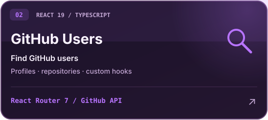
</picture></a>
<br>
<sub>A SPA for finding GitHub users and viewing their profiles and repositories. Custom <code>useFetch</code> and <code>useDebounce</code> hooks.<br><a href="https://github-users-viewer-neon.vercel.app">Demo</a> · <a href="https://github.com/Ira-Ivaa/github-users-viewer">Code</a></sub>
</td>
</tr>
<tr>
<td width="50%" valign="top">
<a href="https://github.com/Ira-Ivaa/mcp-coffee"><picture>
  <source media="(prefers-color-scheme: dark)" srcset="assets/en/mcp-coffee-dark.svg">
  <source media="(prefers-color-scheme: light)" srcset="assets/en/mcp-coffee-light.svg">
  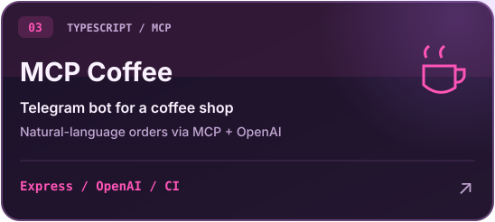
</picture></a>
<br>
<sub>A coffee-shop Telegram bot that takes natural-language orders using a custom MCP server and OpenAI.<br><a href="https://github.com/Ira-Ivaa/mcp-coffee">Code</a></sub>
</td>
<td width="50%" valign="top">
<a href="https://github.com/Hexlet-EducationalPractice/Personal_blog_2026_02_04"><picture>
  <source media="(prefers-color-scheme: dark)" srcset="assets/en/personal-blog-dark.svg">
  <source media="(prefers-color-scheme: light)" srcset="assets/en/personal-blog-light.svg">
  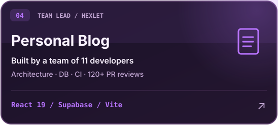
</picture></a>
<br>
<sub>Hexlet College team project: architecture, database design, CI, and reviews of 120+ pull requests in a team of 11 developers.<br><a href="https://github.com/Hexlet-EducationalPractice/Personal_blog_2026_02_04">Team repository</a></sub>
</td>
</tr>
</table>

<details>
<summary><b>ls ~/projects/realtime-chat/</b> — another project</summary>

**[Real-time Chat](https://github.com/Ira-Ivaa/realtime-chat)** — a chat app using **WebSocket**, **JWT authentication** and **Docker**.

</details>

### `irina@ubuntu:~$ tail -f currently-working-on.log`

```diff
+ Film Note: Next.js Server and Client Components
+ Jest: unit tests with TypeScript
+ Looking for a frontend team to grow with
```

<div align="center">

<picture>
  <source media="(prefers-color-scheme: dark)" srcset="assets/en/status-dark.svg">
  <source media="(prefers-color-scheme: light)" srcset="assets/en/status-light.svg">
  
</picture>

<sub>Thanks for stopping by!</sub>

</div>
